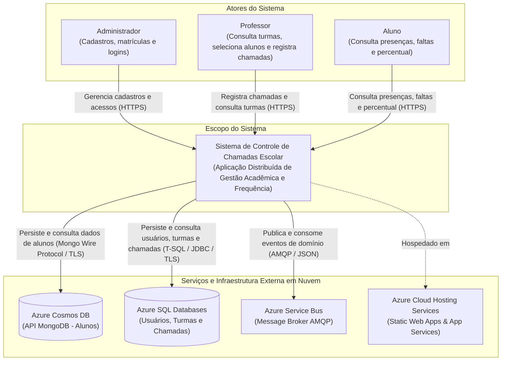
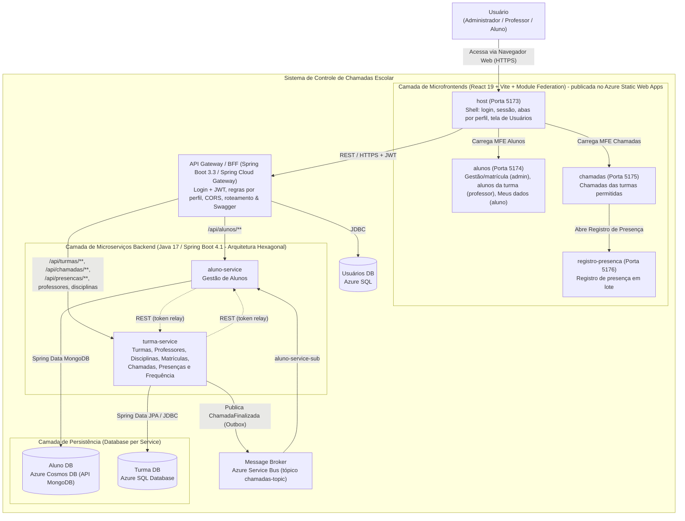
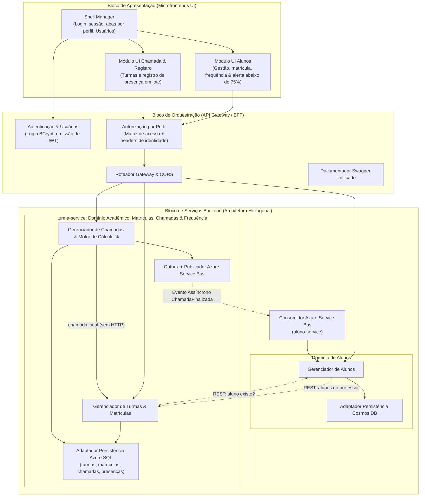
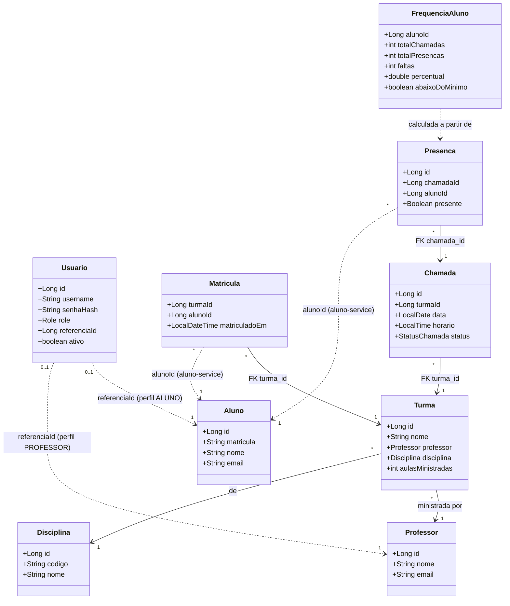
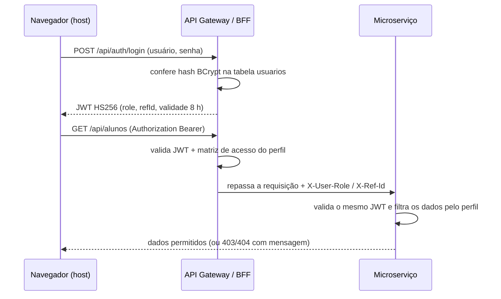
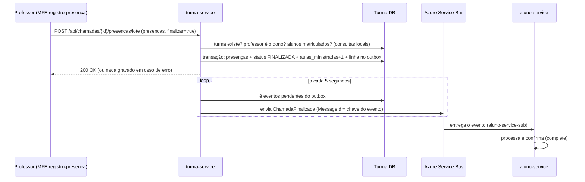
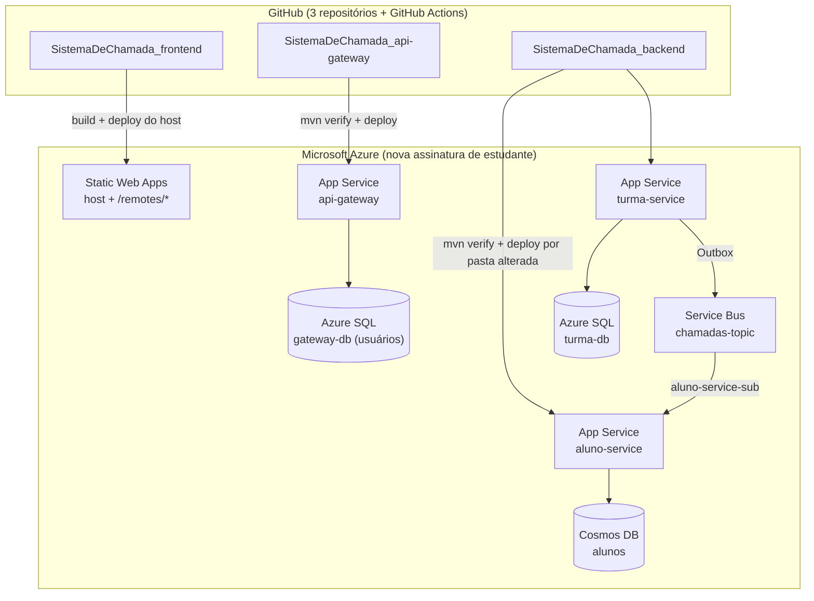
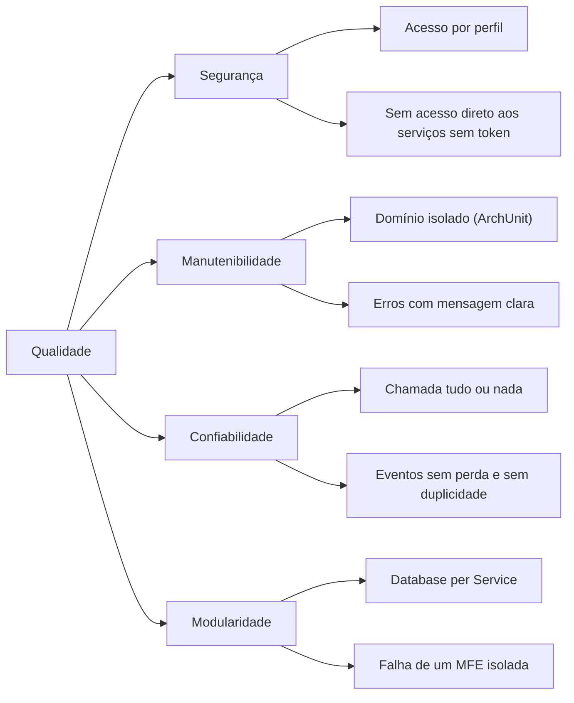

# Integrantes do Grupo

* **Enzo Alves de Barros**

* **Thales Henrique Calil**

* **Vitor de Oliveira Lisboa**

> **Versão 2.1 — atualizada em 15/11/2026.** Este documento é o mesmo nos três repositórios (`SistemaDeChamada_api-gateway`, `SistemaDeChamada_backend`, `SistemaDeChamada_frontend`), em `docs/arc42.md`. O histórico de alterações está na seção 13.

## Status Atual do Projeto (15/11/2026)

Na versão 2.1 o `chamada-service` foi **incorporado ao `turma-service`** (ver ADR-12). O backend passa a ter **3 serviços**: `api-gateway`, `aluno-service` e `turma-service`. Toda a infraestrutura será recriada do zero em uma nova assinatura Azure de estudante.

| Componente | Hospedagem | Situação |
| ----- | ----- | ----- |
| **Frontend** (`host` + 3 microfrontends) | Azure Static Web Apps (somente o `host`) | Pronto; telas por perfil, sessão com expiração e presença em lote. Sem alteração de rotas com a fusão (tudo passa pelo Gateway) |
| **`api-gateway`** (BFF) | Azure App Service + Azure SQL (usuários) | Pronto; `/api/chamadas/**` e `/api/presencas/**` agora roteados para o `turma-service`; origem do frontend configurável (`FRONTEND_URL`) |
| **`aluno-service`** | Azure App Service + Azure Cosmos DB (API MongoDB) | Pronto; consome o evento `ChamadaFinalizada` |
| **`turma-service`** | Azure App Service + Azure SQL | Pronto; turmas, matrículas, **chamadas e presenças**; publica `ChamadaFinalizada` via Outbox |
| ~~`chamada-service`~~ | — | **Removido** (incorporado ao `turma-service`) |

# 1. Introdução e Objetivos

## 1.1 Visão Geral do Projeto

O **Sistema de Controle de Chamadas Escolar (Sistema de Chamadas)** é uma solução distribuída desenvolvida para gerenciar informações acadêmicas e realizar o controle de frequência de alunos em instituições de ensino.

O projeto foi projetado como uma **Arquitetura Orientada a Microserviços e Microfrontends baseada na Nuvem (Microsoft Azure)**. A aplicação permite que professores realizem chamadas de forma simples e ágil durante as aulas, enquanto os alunos consultam seu histórico de presença, quantidade de faltas acumuladas e percentual de frequência, com destaques visuais automáticos para situações de risco acadêmico.

### Principais Atores e Funcionalidades

* **Administrador:** Autentica-se no sistema e mantém os cadastros: alunos, professores, disciplinas, turmas, matrículas (aluno ↔ turma) e logins de acesso. Tem acesso a todas as telas.

* **Professor:** Autentica-se no sistema, consulta suas turmas e disciplinas vinculadas, visualiza a lista de alunos matriculados nelas, registra chamadas com a marcação individual de presença/ausência e consulta o histórico de chamadas realizadas. Não tem acesso a cadastros.

* **Aluno:** Autentica-se no sistema e consulta **somente os próprios dados**: suas disciplinas e turmas, total acumulado de faltas e percentual consolidado de frequência, com destaque visual quando a frequência estiver abaixo do mínimo de $75\%$.

## 1.2 Visão Geral dos Requisitos

| ID | Requisito Funcional (RF) | Ator Principal | Prioridade | Situação |
| ----- | ----- | ----- | ----- | ----- |
| **RF01** | Permitir autenticação de usuários via login seguro (Administrador, Professor e Aluno). | Todos | Alta | Implementado (usuário e senha BCrypt + JWT) |
| **RF02** | Permitir ao professor consultar as turmas e disciplinas sob sua responsabilidade. | Professor | Alta | Implementado |
| **RF03** | Permitir ao professor registrar uma nova chamada associada a uma turma, data e horário. | Professor | Alta | Implementado |
| **RF04** | Permitir ao professor definir a situação de presença (Presente ou Ausente) de cada aluno matriculado. | Professor | Alta | Implementado (registro em lote, tudo ou nada) |
| **RF05** | Permitir ao professor consultar chamadas anteriores de suas turmas. | Professor | Média | Implementado (chamadas finalizadas abrem em modo leitura) |
| **RF06** | Permitir ao aluno consultar seu histórico individual de presenças. | Aluno | Alta | Implementado (por disciplina) |
| **RF07** | Calcular e exibir o total de faltas e o percentual de frequência acumulada do aluno. | Aluno | Alta | Implementado |
| **RF08** | Exibir alerta visual ostensivo quando a frequência calculada do aluno for inferior a $75\%$. | Aluno | Alta | Implementado |
| **RF09** | Tratar adequadamente cenários sem chamadas registradas, evitando divisão por zero no cálculo. | Sistema | Alta | Implementado |
| **RF10** | Permitir ao administrador cadastrar, editar e excluir alunos. | Administrador | Alta | Implementado |
| **RF11** | Permitir ao administrador matricular e remover alunos de turmas. | Administrador | Alta | Implementado |
| **RF12** | Permitir ao administrador criar logins vinculados a alunos e professores, ativar/desativar e redefinir senha. | Administrador | Alta | Implementado |
| **RF13** | Permitir ao administrador cadastrar professores, disciplinas e turmas. | Administrador | Média | API pronta; ainda sem tela (via Swagger) |

**Regras de negócio**

| ID | Regra |
| ----- | ----- |
| **RN06** | Faltas = total de chamadas finalizadas − total de presenças |
| **RN07** | Frequência (%) = presenças ÷ chamadas finalizadas × 100 |
| **RN08** | Frequência abaixo de $75\%$ gera alerta de risco de reprovação |
| **RN09** | Sem chamadas finalizadas, a frequência é $100\%$ (sem divisão por zero) |
| **RN10** | Um aluno tem no máximo uma presença por chamada |
| **RN11** | Só alunos matriculados na turma podem ter presença registrada na chamada dessa turma |
| **RN12** | Chamada finalizada não pode ser alterada nem excluída |
| **RN13** | Não é possível excluir turma com chamadas, nem aluno matriculado em turma |

## 1.3 Objetivos de Qualidade

Com base na norma **ISO/IEC 25010**, os principais objetivos de qualidade direcionadores desta arquitetura são:

| Prioridade | Atributo de Qualidade | Meta Arquitetural | Cenário Concreto |
| ----- | ----- | ----- | ----- |
| **1** | **Segurança (Confidencialidade)** | Autenticação no BFF e autorização por perfil em duas camadas (Gateway e microserviços). | Um aluno não consegue ver dados de outro aluno, nem chamando a URL do microserviço diretamente. |
| **2** | **Manutenibilidade & Testabilidade** | Isolamento de regras de negócio usando **Arquitetura Hexagonal**, verificado por testes de arquitetura (ArchUnit). | Alterações no banco de dados ou nas APIs do Spring Boot não devem impactar a camada de domínio nem os testes de regras de frequência. |
| **3** | **Confiabilidade (Integridade)** | Transações atômicas, padrão Outbox e consumidores idempotentes. | Uma queda de conexão durante o registro de presença não deixa a chamada pela metade; um evento entregue duas vezes é processado uma vez. |
| **4** | **Modularidade & Desacoplamento** | Segregação estrita de bancos de dados (*Database per Service*). | Falhas ou manutenção no banco de dados de turmas não impedem a consulta de chamadas já gravadas no banco de chamadas. |
| **5** | **Deploy Independente e Custo** | Autonomia de deploy em Microfrontends e Microserviços, com o menor número de recursos pagos. | Um push que altera só o `turma-service` reimplanta só ele; o backend roda com 2 App Services e 2 bancos (+ o banco de usuários do Gateway). |

## 1.4 Partes Interessadas

| Função / Ator | Contato | Expectativas em relação à Arquitetura |
| ----- | ----- | ----- |
| **Administrador (Secretaria)** | `secretaria@escola.edu.br` | Cadastros e matrículas centralizados, controle de quem acessa o sistema. |
| **Professores** | `professores@escola.edu.br` | Interface rápida e responsiva para lançamento de presenças em sala de aula, sem lentidões. |
| **Alunos** | `alunos@escola.edu.br` | Transparência total no cálculo de faltas e percentual de presença com alertas visuais prévios. |
| **Equipe de Desenvolvimento (Grupo 7)** | `devs@grupo7.edu.br` | Arquitetura modular limpa (Hexagonal Architecture), repositórios separados no GitHub e facilidade para testes unitários/arquiteturais. |
| **Professor Avaliador** | `docente@universidade.edu.br` | Conformidade estrita aos requisitos da atividade (BFF, Microservices, Microfrontends, Database per Service, Azure Service Bus, ArchUnit, C4 Model completo no arc42, somente o host publicado no Static Web Apps). |

# 2. Restrições Arquiteturais

As restrições abaixo delimitam as decisões de design, implementação e implantação do sistema.

## 2.1 Restrições Legais e de Proteção de Dados

| Restrição | Origem | Explicação |
| ----- | ----- | ----- |
| **Conformidade com a LGPD** | Legislação (Lei nº 13.709/2018) | O tratamento de dados cadastrais de alunos e professores (nome, e-mail, matrícula) deve garantir privacidade. O aluno só pode consultar o seu próprio histórico de presença; o professor só vê alunos das suas turmas. Senhas são armazenadas apenas como hash BCrypt. |

## 2.2 Restrições Organizacionais e Acadêmicas

| Restrição | Origem | Explicação |
| ----- | ----- | ----- |
| **Prazo Semestral de Entrega** | Calendário Acadêmico | A solução completa deve ser projetada, desenvolvida, testada e implantada na nuvem até a data limite da avaliação. |
| **Tamanho da Equipe** | Organização do Grupo | A equipe é composta por 3 integrantes, exigindo forte divisão de responsabilidades entre 3 repositórios GitHub (Frontend, Gateway/BFF e Backend). |
| **Tecnologias Obrigatórias** | Ementa da Disciplina | Uso obrigatório de Java Spring Boot, React (Vite + Module Federation), API Gateway/BFF, Azure Service Bus, Azure App Service e testes automatizados (incluindo ArchUnit). |
| **Somente o Host no Static Web Apps** | Requisito do Professor | Por segurança, apenas o `host` é publicado; os microfrontends remotos são servidos como arquivos estáticos dentro dele (`/remotes/<mfe>/`). |
| **Demonstração em Vídeo** | Critério de Avaliação | Apresentação em vídeo publicado no YouTube (não listado) com todos os integrantes com câmera aberta demonstrando a aplicação em nuvem (sem utilizar localhost). |

## 2.3 Restrições Técnicas

| Restrição | Explicação |
| ----- | ----- |
| **Java 17** | Versão usada nos quatro serviços Spring Boot (pilha Java 17 no App Service). |
| **Spring Boot 4.1** (microserviços) e **Spring Boot 3.3 + Spring Cloud Gateway** (BFF) | O Gateway reativo usa Spring Cloud Gateway 2023.x. |
| **Vite 7 nos remotos** | O Vite 8 mostrou-se incompatível com `@originjs/vite-plugin-federation`; os remotos foram mantidos no Vite 7. |
| **JavaScript (sem TypeScript) nos microfrontends** | O TypeScript conflitou com o Module Federation na resolução dos módulos remotos. |

## 2.4 Restrições de Nuvem e Orçamento (*Cloud Limits*)

| Restrição | Provedor / Componente | Limitação Técnica / Financeira |
| ----- | ----- | ----- |
| **Créditos Acadêmicos Azure** | Microsoft Azure for Students | Toda a infraestrutura na nuvem deve operar dentro da cota gratuita fornecida para contas de estudantes. |
| **Azure SQL Database Free Tier** | Microsoft Azure | Recursos limitados por instância de banco relacional (`turma-service` e usuários do Gateway). Exige consultas enxutas e pools de conexão pequenos (máx. 5). Bancos *serverless* podem pausar e demorar a responder na primeira conexão. Motivou a fusão do `chamada-service` no `turma-service` (um banco a menos). |
| **Azure Cosmos DB / DocumentDB (API MongoDB)** | Microsoft Azure | Substituiu o MongoDB Atlas M0. Acesso pelo protocolo MongoDB com a *Primary Connection String*. |
| **App Service (planos de baixo custo)** | Microsoft Azure | Planos gratuitos hibernam após inatividade; com vários apps no mesmo plano a inicialização da JVM fica lenta. |

# 3. Contexto e Escopo

## 3.1 Contexto Negocial

### Componentes Externos e Interfaces de Negócio

| Entidade / Sistema | Entradas (Inbound) | Saídas (Outbound) |
| ----- | ----- | ----- |
| **Administrador** | Credenciais, cadastros de alunos, matrículas e logins. | Visão completa de alunos, turmas, chamadas e frequências. |
| **Professor** | Credenciais de acesso, seleção de turma, data e horário, marcações de presenças e ausências. | Consulta de turmas associadas, lista de alunos matriculados e confirmação do registro de chamada. |
| **Aluno** | Credenciais de acesso, solicitações de consulta ao histórico acadêmico. | Visualização das faltas, percentual de frequência por disciplina e alertas visuais de risco ($<75\%$). |
| **Azure Cosmos DB (API MongoDB)** | Documentos BSON de alunos transmitidos via TLS. | Confirmação de persistência dos dados cadastrais de estudantes. |
| **Azure SQL Databases** | Instruções T-SQL de leitura e escrita via JDBC Driver (Porta 1433, TLS). | Transações relacionais de usuários, turmas, matrículas, chamadas e presenças. |
| **Azure Service Bus** | Eventos de domínio em JSON publicados via protocolo AMQP. | Notificações assíncronas entregues aos microserviços consumidores. |

### C1 - Diagrama de Contexto (Modelo C4)



## 3.2 Contexto Técnico

### Mapeamento de Interfaces Técnicas e Protocolos

| Interface / Canal | Protocolo | Formato dos Dados | Mapeamento Negocial / Técnico |
| ----- | ----- | ----- | ----- |
| **Microfrontend ↔ API Gateway/BFF** | HTTPS | JSON + `Authorization: Bearer <JWT>` | Requisições REST da SPA; CORS restrito às origens configuradas no Gateway (`FRONTEND_URL`). |
| **API Gateway/BFF ↔ Microserviços** | HTTPS / REST | JSON + JWT + headers de identidade | Roteamento com repasse de `X-User-Id`, `X-User-Role`, `X-Ref-Id`, `X-Username`. |
| **aluno-service ↔ turma-service** | HTTPS / REST | JSON + JWT do usuário (*token relay*) | O `turma-service` valida se o aluno existe ao matricular e monta as listas de chamada; o `aluno-service` consulta os alunos do professor e se o aluno tem matrícula antes de excluí-lo. |
| **aluno-service ↔ Cosmos DB** | Mongo Wire Protocol | BSON | Spring Data MongoDB com conexão criptografada; ids `Long` gerados por sequência. |
| **gateway / turma-service ↔ Azure SQL** | JDBC / TDS | Relacional T-SQL | JDBC / Spring Data JPA sobre TLS; esquema versionado com Flyway. |
| **turma-service → Azure Service Bus → aluno-service** | AMQP v1.0 | JSON Event Payload | Publicação (via Outbox) e consumo assíncrono do evento `ChamadaFinalizadaEvent`. |

### C2 - Diagrama de Contêineres (Modelo C4)



# 4. Estratégia de Solução

A arquitetura foi projetada atendendo a decisões fundamentais de desacoplamento, segurança e escalabilidade:

## 4.1 Microfrontends com React e Module Federation

A interface web é dividida em pequenas aplicações React 19 independentes mantidas via Vite. A integração em tempo de execução ocorre através do **Module Federation**:

* **`host` (Porta 5173):** Atua como container/shell principal: login, sessão (expira junto com o JWT), abas visíveis conforme o perfil, tela de **Usuários** (somente administrador) e carregamento dos remotos com novas tentativas e isolamento de falhas (*error boundary*).

* **`alunos` (Porta 5174):** Microfrontend com uma visão por perfil: gestão de alunos e matrículas (administrador), alunos das turmas do professor (professor) e "Meus dados" com a frequência por disciplina (aluno).

* **`chamadas` (Porta 5175):** Microfrontend dedicado à listagem, criação e exclusão de chamadas das turmas permitidas.

* **`registro-presenca` (Porta 5176):** Componente remoto aberto a partir do microfrontend `chamadas` para registrar a presença da turma inteira em uma única operação (ou visualizar, se a chamada já foi finalizada).

Em produção, **somente o `host` é publicado** no Azure Static Web Apps; os remotos são compilados e copiados para `/remotes/<mfe>/assets/` dentro dele, na mesma origem.

## 4.2 API Gateway & Backend for Frontend (BFF)

Para impedir que a aplicação cliente acesse os microserviços diretamente, foi introduzida uma camada unificada de **API Gateway / BFF**:

* Centraliza o ponto de entrada das requisições HTTPS.

* **Autentica** os usuários (senha com hash BCrypt em tabela própria) e emite o **JWT** com perfil e vínculo (`refId` = id do aluno ou do professor).

* Aplica a **matriz de autorização por perfil** e funciona como **BFF de identidade**: descarta headers de identidade enviados pelo cliente e repassa aos microserviços quem é o usuário.

* Aplica as políticas globais de Cross-Origin Resource Sharing (**CORS**).

* Disponibiliza a documentação unificada das APIs via **Swagger/OpenAPI**.

A consolidação de dados para o painel do aluno (turmas + chamadas) é feita no `turma-service` (`GET /api/presencas/aluno/{id}`), localmente, já que turmas, matrículas e chamadas estão no mesmo serviço; o Gateway apenas roteia.

## 4.3 Database per Service com Bancos Híbridos

Cada microserviço possui autonomia absoluta de armazenamento:

1. **`aluno-service`:** Utiliza **Azure Cosmos DB (API MongoDB)**, orientado a documentos, ideal para o armazenamento de perfis cadastrais. Ids numéricos (`Long`) gerados por sequência atômica.

2. **`turma-service`:** Utiliza **Azure SQL Database** (relacional) para professores, disciplinas, turmas, **matrículas, chamadas e presenças**. Por estarem no mesmo banco, chamadas têm chave estrangeira para turmas e presenças para chamadas.

3. **`api-gateway`:** Utiliza um banco **Azure SQL** próprio apenas para a tabela de usuários (login).

Referências entre serviços diferentes (ex.: `alunoId` na matrícula ou na presença) são guardadas como ids `Long`, sem chave estrangeira entre bancos; a existência do aluno é verificada por API.

## 4.4 Comunicação Assíncrona com Azure Service Bus

Requisições de leitura ou atualizações diretas utilizam HTTP/REST via BFF. Quando uma chamada é **finalizada** no `turma-service`, três coisas acontecem na **mesma transação**: o status passa a FINALIZADA, a turma soma 1 em `aulas_ministradas` e o evento `ChamadaFinalizadaEvent` é gravado na tabela **Outbox**. Um agendador publica os eventos pendentes no tópico `chamadas-topic` do **Azure Service Bus** a cada 5 segundos, e o `aluno-service` os consome de forma assíncrona.

## 4.5 Arquitetura Hexagonal no Backend

Os três microserviços Java Spring Boot utilizam **Arquitetura Hexagonal (Ports and Adapters)**. As regras de negócio e fórmulas matemáticas ficam isoladas dentro do pacote `domain`, totalmente livres de anotações do Spring Boot ou do banco de dados. O acoplamento com tecnologias externas ocorre através de portas e adaptadores na camada `infrastructure`. A regra é verificada automaticamente por testes **ArchUnit**.

## 4.6 Segurança em Profundidade

As URLs dos App Services são públicas; por isso cada microserviço também **valida o JWT** (mesmo segredo do Gateway, HS256) e aplica as regras do perfil no `SecurityConfig` e nos casos de uso, filtrando os dados (professor → suas turmas; aluno → ele mesmo). Chamadas entre `aluno-service` e `turma-service` repassam o token do usuário (*token relay*).

# 5. Visão de Blocos de Construção (Building Block View)

## 5.1 Visão Sistêmica Geral de Caixa Branca (C3 - Nível de Blocos Funcionais)

A decomposição lógica do sistema é apresentada através dos seus blocos funcionais de negócio:



## 5.2 Nível 2 - Estrutura Interna dos Componentes

### 5.2.1 Caixa Branca Interna de um Microserviço Backend (Arquitetura Hexagonal)

Os dois microserviços backend (`aluno-service` e `turma-service`) são estruturados segundo os pacotes da Arquitetura Hexagonal:

```mermaid
flowchart TD
    subgraph InfrastructureIn ["Adaptadores de Entrada (Infrastructure In)"]
        Controller["REST Controllers<br/>(ex: ChamadaController)"]
        Listener["Listener Azure Service Bus<br/>(ex: AzureServiceBusListenerAdapter)"]
        ErrorHandler["GlobalExceptionHandler<br/>(400/403/404/409/502)"]
    end

    subgraph ApplicationPorts ["Camada de Aplicação & Portas (Application)"]
        InputPort["Input Ports (Interfaces UseCase)<br/>(ex: GerenciarPresencaUseCase)"]
        UseCaseImpl["Application Services<br/>(ex: PresencaService - regras + perfil)"]
        OutputPort["Output Ports<br/>(ex: PresencaRepositoryPort, TurmaServicePort, UsuarioLogadoPort)"]
    end

    subgraph DomainCore ["Núcleo de Domínio Puro (Domain Core - Sem Spring)"]
        Entities["Entidades de Domínio<br/>(ex: Chamada, Presenca, FrequenciaAluno)"]
        DomainServices["Services de Domínio<br/>(ex: CalculadorFrequenciaDomainService)"]
    end

    subgraph InfrastructureOut ["Adaptadores de Saída (Infrastructure Out)"]
        DBAdapters["Adaptadores de Banco de Dados<br/>(Spring Data JPA / Mongo)"]
        HttpAdapters["Clientes HTTP de outros serviços<br/>(token relay)"]
        MsgAdapters["Adaptadores de Mensageria<br/>(Outbox + Service Bus)"]
        SecAdapter["Usuário logado a partir do JWT"]
    end

    Controller --> InputPort
    Listener --> InputPort
    UseCaseImpl -.->|"implementa"| InputPort
    UseCaseImpl --> Entities
    UseCaseImpl --> DomainServices
    UseCaseImpl --> OutputPort
    DBAdapters -.->|"implementa"| OutputPort
    HttpAdapters -.->|"implementa"| OutputPort
    MsgAdapters -.->|"implementa"| OutputPort
    SecAdapter -.->|"implementa"| OutputPort
```



#### Organização da Estrutura de Diretórios (Java Spring Boot):

```
com.sistema.[servico]
├── domain                      # Núcleo de Domínio Puro (Entidades e Regras de Negócio)
│   ├── model                   # Entidades de Domínio (ex: Chamada, Presenca, FrequenciaAluno)
│   ├── event                   # Eventos de Domínio (ex: ChamadaFinalizadaEvent)
│   └── service                 # Serviços de Domínio (ex: CalculadorFrequenciaDomainService)
├── application                 # Orquestração e Casos de Uso
│   ├── exception               # Exceções de aplicação (NaoEncontrado, RegraNegocio, AcessoNegado...)
│   ├── security                # Perfil e UsuarioLogado (sem Spring)
│   ├── ports
│   │   ├── in                  # Interfaces dos Casos de Uso (Input Ports)
│   │   └── out                 # Persistência, mensageria, outros serviços, usuário logado (Output Ports)
│   └── usecase/service         # Implementação dos Casos de Uso
├── infrastructure              # Tecnologias Externas e Frameworks
│   ├── adapters
│   │   ├── in/web              # Controllers REST, DTOs e GlobalExceptionHandler
│   │   ├── in/messaging        # Listener do Azure Service Bus
│   │   ├── out/persistence     # Entities JPA/Mongo e Adaptadores de Banco
│   │   ├── out/messaging       # Outbox e publicação no Azure Service Bus
│   │   └── out/http            # Clientes REST de outros microserviços
│   ├── security                # Validação do JWT (Spring Security Resource Server)
│   ├── http                    # Cliente HTTP com token relay e tradução de erros
│   └── config                  # Beans de Configuração do Spring Boot
```

### 5.2.2 Caixa Branca Interna do API Gateway / BFF

```
com.sistemadechamada_apigateway.gateway
├── controller      # AuthController (login, /me), UsuarioController (somente ADMIN)
├── service         # UsuarioService (autenticação BCrypt, cadastro de logins)
├── repository      # UsuarioRepository (JDBC, executado fora das threads reativas)
├── model           # Usuario, Role, UsuarioAutenticado
├── dto             # LoginRequest/Response, CriarUsuario, AlterarSenha, UsuarioResponse
├── security        # JwtTokenProvider, JwtAuthenticationWebFilter, RegrasDeAcesso (matriz por perfil)
├── filter          # UsuarioHeadersGlobalFilter (BFF de identidade)
├── config          # SecurityConfig (CORS, Actuator, autorização), AdminInicialSeeder
└── exception       # ApiException, GlobalExceptionHandler
```

Regras verificadas por ArchUnit: controller não acessa repository; model não depende do Spring nem de outras camadas; injeção somente por construtor; pacotes sem dependências cíclicas.

### 5.2.3 Caixa Branca Interna dos Microfrontends

```
frontend/
├── host/                 # Shell (único publicado)
│   ├── src/App.jsx       # Abas por perfil + RemoteBoundary + lazy com novas tentativas
│   ├── src/config/       # perfis.js (abas por perfil), lazyRemoto.js (novas tentativas)
│   ├── src/components/   # Login, Usuarios (ADMIN), RemoteBoundary
│   ├── src/api/          # fetchWithAuth.js (sessão, JWT, 401 -> login)
│   └── public/staticwebapp.config.json   # Única configuração lida pelo Static Web Apps
├── alunos/  chamadas/  registro-presenca/   # Remotos
│   ├── src/components/   # Componente exposto via Module Federation
│   ├── src/utils/        # Funções puras (testadas)
│   ├── src/api/          # Cópia idêntica do fetchWithAuth.js
│   └── tests/            # Testes unitários e de arquitetura (node:test)
```

## 5.3 Nível 3 - Modelo de Domínio e Relacionamentos Conceituais



Linhas contínuas são chaves estrangeiras no banco do `turma-service`. Linhas tracejadas são referências por id a outro serviço (aluno no `aluno-service`, usuário no Gateway), sem chave estrangeira; a integridade é verificada por API.

# 6. Visão de Tempo de Execução (Runtime View)

## 6.1 Login e Requisição Autenticada



## 6.2 Registro de Chamada em Lote e Publicação do Evento (Outbox)



## 6.3 Consulta de Frequência pelo Aluno

1. O aluno abre "Meus dados"; o MFE `alunos` chama `GET /api/alunos/{seuId}` e `GET /api/presencas/aluno/{seuId}`.
2. O Gateway só permite esses caminhos se o `{seuId}` for igual ao `refId` do token.
3. O `turma-service` busca localmente as turmas do aluno (matrículas) e calcula, para cada uma, presenças, faltas, percentual e alerta ($<75\%$) com o `CalculadorFrequenciaDomainService`.

## 6.4 Falha no Processamento de Evento

Exceção no consumidor (`aluno-service`) → a mensagem é devolvida (`abandon`) → o Service Bus entrega novamente → após o limite de entregas da subscription (padrão 10), a mensagem vai para a **Dead-Letter Queue**. Mensagens com JSON inválido vão direto para a Dead-Letter Queue.

## 6.5 Sessão Expirada

O host encerra a sessão quando o JWT vence; qualquer resposta 401 de um microfrontend também dispara o evento de sessão encerrada e o usuário volta ao login com o aviso "Sua sessão expirou".

# 7. Visão de Implantação (Deployment View)



## 7.1 Recursos a Criar na Nova Assinatura

| # | Recurso | Observação |
| ----- | ----- | ----- |
| 1 | **Azure SQL** (1 servidor, 2 bancos: `gateway-db` e `turma-db`) | Rede: "Permitir que serviços e recursos do Azure acessem este servidor"; TLS mínimo 1.2. Tabelas criadas pelo Flyway |
| 2 | **Azure Cosmos DB (API MongoDB)** | Banco do `aluno-service` |
| 3 | **Service Bus** | Tópico `chamadas-topic` com a subscription `aluno-service-sub` |
| 4 | **3 App Services (Java 17)** | `api-gateway`, `aluno-service`, `turma-service` |
| 5 | **Static Web Apps** | Somente o `host`; o Azure gera um novo workflow e secret de deploy |

## 7.2 Variáveis de Ambiente (lista completa)

| Variável | api-gateway | aluno-service | turma-service | Valor |
| ----- | :-: | :-: | :-: | ----- |
| `JWT_SECRET` | x | x | x | Texto aleatório de 32+ caracteres, **igual nos três** |
| `GATEWAY_DB_URL` | x | | | JDBC do `gateway-db` |
| `GATEWAY_DB_USER`, `GATEWAY_DB_PASSWORD` | x | | | Credenciais do Azure SQL |
| `ADMIN_INITIAL_PASSWORD` | x | | | Senha do primeiro admin (8+ caracteres); pode ser removida após o primeiro acesso |
| `FRONTEND_URL` | x | | | URL do Static Web Apps (liberada no CORS) |
| `ALUNO_SERVICE_URL` | x | | x | `https://<app do aluno-service>.azurewebsites.net` |
| `TURMA_SERVICE_URL` | x | x | | `https://<app do turma-service>.azurewebsites.net` |
| `SPRING_DATA_MONGODB_URI` | | x | | Primary Connection String do Cosmos DB |
| `AZURE_SQL_URL` | | | x | JDBC do `turma-db` |
| `AZURE_SQL_USERNAME`, `AZURE_SQL_PASSWORD` | | | x | Credenciais do Azure SQL |
| `AZURE_SERVICEBUS_CONNECTION_STRING` | | x | x | Connection string do namespace do Service Bus |

No GitHub do frontend: variável `VITE_API_URL` = URL do `api-gateway`.

Formato das URLs JDBC: `jdbc:sqlserver://<servidor>.database.windows.net:1433;database=<banco>;encrypt=true;trustServerCertificate=false;hostNameInCertificate=*.database.windows.net;loginTimeout=30;`

## 7.3 Pipelines (GitHub Actions)

| Repositório | Gatilho | Etapas |
| ----- | ----- | ----- |
| `api-gateway` | push em `main` | `mvn verify` (testes) → deploy |
| `backend` | push em `master`, **somente a pasta do serviço alterado** (`aluno-service` ou `turma-service`) | `mvn verify` → deploy daquele serviço |
| `frontend` | push em `main` | build dos remotos e do host → verifica `remoteEntry.js` → injeta a URL do Gateway na CSP → deploy somente do host |

**Ordem do primeiro deploy:** `api-gateway` → `turma-service` → `aluno-service` → frontend.

# 8. Conceitos Transversais (Cross-cutting Concepts)

## 8.1 Segurança

* **Autenticação:** login com senha BCrypt; JWT HS256 com `role`, `userId`, `refId`, emissor fixo e validade de 8 h. Segredo apenas em variável de ambiente (`JWT_SECRET`, mínimo 32 caracteres, igual nos quatro serviços).
* **Autorização em duas camadas:** matriz por perfil no Gateway (`RegrasDeAcesso`) e regras nos casos de uso dos microserviços.

| Perfil | Pode | Não pode |
| ----- | ----- | ----- |
| **ADMIN** | Tudo, incluindo cadastros, matrículas e logins | — |
| **PROFESSOR** | Ler alunos, turmas e chamadas **das suas turmas**; criar, registrar, finalizar e excluir chamadas abertas | Qualquer cadastro; dados de turmas de outros professores |
| **ALUNO** | Ler os próprios dados, turmas e frequência (`/api/alunos/{seuId}`, `/api/turmas/aluno/{seuId}`, `/api/presencas/aluno/{seuId}`) | Qualquer escrita; dados de outros alunos |

* **Superfície reduzida:** Actuator só com `health`; CORS restrito às origens do `application.yml`; microserviços sem CORS.
* **Frontend:** sessão no `sessionStorage`, encerrada ao expirar o token ou receber 401; *Content Security Policy* restringe scripts à própria origem e conexões ao Gateway.

## 8.2 Tratamento de Erros

Todos os serviços respondem erros em JSON com `status`, `erro`, `mensagem`, `servico` e `caminho`: **400** validação, **403** sem permissão, **404** não encontrado, **409** conflito ou regra de negócio, **502** falha ao chamar outro serviço e **500** apenas para o inesperado (com stack trace no Log stream).

## 8.3 Persistência e Esquema

* **Flyway** em todos os bancos SQL (`src/main/resources/db/migration`); Hibernate com `ddl-auto=none`. No `turma-service`: V1 (professores, disciplinas, turmas), V2 (matrículas e aulas ministradas), V3 (chamadas e presenças), V4 (Outbox).
* Integridade no banco do `turma-service`: chamada → turma (FK, sem exclusão em cascata: turma com chamadas não pode ser excluída); uma chamada por turma/data/horário; presença → chamada (FK); presença única por (chamada, aluno); matrícula com chave (turma, aluno).
* A matrícula do aluno na turma da chamada é validada pela aplicação antes de gravar a presença.

## 8.4 Mensageria

Padrão **Outbox** no `turma-service` (tabela `outbox_eventos`, envio a cada 5 s por um `@Scheduled`, `MessageId` = chave do evento). O consumidor (`aluno-service`) confirma (`complete`) só após sucesso; falhas repetidas vão para a Dead-Letter Queue. O `turma-service` não consome o próprio evento: as aulas ministradas são somadas na mesma transação da finalização.

## 8.5 Testes Automatizados

| Repositório | Testes |
| ----- | ----- |
| `api-gateway` | Unitários (JWT, login, matriz por perfil, headers de identidade) |
| `backend` / `aluno-service` | Unitários (regras por perfil, unicidade, integridade) + **ArchUnit** (domínio isolado) |
| `backend` / `turma-service` | **3 regras ArchUnit** (domínio puro; aplicação sem dependência de adaptadores; entrada sem acesso à saída) + **5 testes unitários** (exclusão de turma com chamadas, acesso do professor, presença em lote só de matriculados, finalização com aulas ministradas e Outbox, cálculo de frequência) |
| `frontend` | Planejado: 3 testes de arquitetura e 3 a 5 unitários por microfrontend |

Os testes rodam nos pipelines antes do deploy; teste falhando bloqueia a publicação.

## 8.6 Configuração e Observabilidade

Valores sensíveis somente por variável de ambiente, sem valor padrão no código: se faltar, o serviço **não sobe** e o erro aparece no deploy. Logs consultados no **Log stream** do App Service.

# 9. Decisões de Arquitetura (ADRs)

| ID | Decisão | Alternativas Consideradas | Justificativa |
| ----- | ----- | ----- | ----- |
| **ADR-01** | Microfrontends com Module Federation, publicando somente o host | Quatro sites separados | Requisito do professor; uma única origem, sem CORS entre microfrontends |
| **ADR-02** | API Gateway como BFF de identidade (login, JWT, matriz por perfil) | Autenticação em cada serviço | Ponto único de entrada e de controle de acesso |
| **ADR-03** | Usuários em tabela própria do Gateway (Azure SQL) | Usuários fixos por variável; Entra ID | Cadastro pela tela de Usuários, sem custo extra |
| **ADR-04** | Microserviços também validam o JWT | Confiar apenas no Gateway | URLs dos App Services são públicas (defesa em profundidade) |
| **ADR-05** | Id de aluno `Long` gerado por sequência no Cosmos DB | Manter ObjectId (texto) | Tipo único entre os serviços; presenças e matrículas já usavam `Long` |
| **ADR-06** | Matrícula aluno ↔ turma no `turma-service` | No `aluno-service` | A turma é o agregado dono do vínculo |
| **ADR-07** | Evento `ChamadaFinalizada` publicado via Outbox | Publicar direto após salvar; evento `MatriculaRealizada` | Evita chamada finalizada sem evento; o fato relevante para os outros serviços é a chamada finalizada (consumido pelo `aluno-service`) |
| **ADR-08** | Flyway com *baseline* | `ddl-auto=update` | Esquema previsível e versionado em produção |
| **ADR-09** | Presença em lote (uma requisição, uma transação) | Um POST por aluno | Sem chamada pela metade; repetir a operação é seguro |
| **ADR-10** | Testes do frontend com `node:test` | Vitest / Jest | Sem novas dependências nem alteração do `package-lock.json` |
| **ADR-11** | Deploy do backend filtrado por pasta | Deploy de todos os serviços a cada push | Economia de build e de reinícios |
| **ADR-12** | Incorporar o `chamada-service` ao `turma-service` (mesmo banco Azure SQL) | Manter 3 serviços de backend | Menos 1 App Service e 1 banco na nova assinatura de estudante; o `turma-service` já era estável no Azure enquanto o `chamada-service` falhava na conexão TLS; turma, matrícula, chamada e presença são o mesmo contexto de negócio, e as validações deixam de ser chamadas HTTP |

# 10. Requisitos de Qualidade

## 10.1 Árvore de Qualidade



## 10.2 Cenários de Qualidade

| Atributo | Cenário | Resposta Esperada |
| ----- | ----- | ----- |
| Segurança | Aluno chama `GET /api/alunos/{outro id}` com o próprio token | 403 no Gateway (e no serviço, se chamado direto) |
| Segurança | Alguém chama a URL do App Service de um microserviço sem token | 401 |
| Confiabilidade | A conexão cai no meio do registro de presença | Nada é gravado; repetir funciona |
| Confiabilidade | Service Bus indisponível ao finalizar a chamada | A chamada é finalizada; o evento fica no Outbox e é enviado depois |
| Confiabilidade | A chamada é finalizada duas vezes | Aulas ministradas contam uma vez e nenhum evento duplicado é gerado |
| Diagnosticabilidade | Consulta a um id inexistente | 404 com mensagem, serviço e caminho |
| Disponibilidade (frontend) | O `remoteEntry.js` de um microfrontend não carrega | Novas tentativas; se falhar, só aquela aba mostra erro |
| Manutenibilidade | O domínio passa a depender do Spring, ou um microfrontend importa outro | Teste de arquitetura falha e bloqueia o deploy |

# 11. Riscos e Débitos Técnicos

## 11.1 Incidente Resolvido — `chamada-service` Fora do Ar

* **Sintoma (14/11/2026):** na subida, o Flyway/HikariCP do `chamada-service` não conectava ao Azure SQL (`SSLException: Connection reset by peer`, SQL State `08S01`) e o App Service respondia 503, enquanto o `turma-service`, com a mesma configuração, conectava normalmente.
* **Resolução:** o `chamada-service` foi incorporado ao `turma-service` (ADR-12), que usa a configuração de conexão já validada no Azure. Chamadas e presenças passaram a usar o mesmo banco das turmas.

## 11.2 Riscos e Débitos

| Item | Impacto | Tratamento Sugerido |
| ----- | ----- | ----- |
| `turma-service` concentra turmas e chamadas | Mais carga e mais responsabilidade em um único serviço | Aceitável no volume atual; separar novamente se a escala exigir |
| `aluno-service` consome `ChamadaFinalizada` apenas com registro em log | Mensageria sem efeito de negócio no consumidor | Usar o evento para notificar o aluno ou atualizar um resumo de frequência |
| Professores, disciplinas e turmas sem tela (apenas Swagger) | Operação manual pelo administrador | Criar microfrontend de turmas |
| Testes do frontend ainda não versionados | Regressões no frontend não bloqueiam o deploy | Implementar o escopo acordado (3 de arquitetura + 3 a 5 unitários por MFE) |
| Host no Vite 8 e remotos no Vite 7 | Possível incompatibilidade do Module Federation no host | Padronizar no Vite 7 se houver erro de build |
| Segredo JWT compartilhado (HS256) | Vazamento em um serviço compromete todos | Evoluir para chaves assimétricas (RS256/JWKS) ou Microsoft Entra ID |
| URLs públicas dos App Services | Exposição desnecessária (mitigada pelo JWT) | Restrições de acesso / VNet aceitando apenas o Gateway |
| Sem *refresh token* | Novo login a cada 8 h | Aceitável no escopo atual |
| Planos gratuitos hibernam | Primeira requisição lenta; agendador do Outbox para | Plano Basic com *Always On* |
| *Content Security Policy* restritiva | Recurso inline novo pode deixar a tela em branco | Ajustar a CSP no `staticwebapp.config.json` do host |

# 12. Glossário

| Termo | Definição |
| ----- | ----- |
| **BFF (Backend for Frontend)** | Camada entre o frontend e os serviços; aqui autentica, aplica as regras por perfil e repassa a identidade |
| **Host / Shell** | Aplicação React que carrega os microfrontends; único item publicado no Static Web Apps |
| **Microfrontend / Remoto** | Aplicação React carregada pelo host via Module Federation (`remoteEntry.js`) |
| **JWT** | Token assinado que identifica o usuário, seu perfil e seu vínculo (`refId`) |
| **refId / referenciaId** | Id do aluno ou do professor vinculado ao login |
| **Matrícula** | Vínculo aluno ↔ turma (tabela `turma_alunos` no `turma-service`) |
| **Outbox** | Tabela onde o evento é gravado junto com a mudança, para envio posterior ao broker |
| **Dead-Letter Queue (DLQ)** | Fila de mensagens que não puderam ser processadas |
| **Idempotência** | Processar o mesmo evento mais de uma vez produz o mesmo resultado que processá-lo uma vez |
| **Baseline (Flyway)** | Marcar um banco já existente como estando na versão 1 do esquema |
| **Token relay** | Repasse do JWT do usuário quando um microserviço chama outro |

# 13. Histórico de Alterações

| Versão | Data | Alterações |
| ----- | ----- | ----- |
| 1.0 | Novembro de 2026 | Versão inicial do documento (seções 1 a 5) |
| 2.0 | 14/11/2026 | Inclusão do Administrador e dos RF10–RF13; login real com JWT e regras por perfil (BFF de identidade); segurança também nos microserviços; Cosmos DB no lugar do MongoDB Atlas; Java 17; ids de aluno `Long`; matrículas no `turma-service`; evento `ChamadaFinalizada` via Outbox no lugar de `MatriculaRealizada`; Flyway; presença em lote; publicação somente do host; diagramas C4 atualizados; seções 6 a 12 escritas; status atual e incidente do `chamada-service` |
| 2.1 | 15/11/2026 | `chamada-service` incorporado ao `turma-service` (mesmo banco; validações locais; aulas ministradas na mesma transação; Outbox publicado pelo `turma-service` e consumido pelo `aluno-service`); Gateway roteando chamadas/presenças para o `turma-service` e com `FRONTEND_URL`; diagramas C2, C3, runtime e implantação atualizados; lista completa de variáveis para a nova assinatura; incidente do `chamada-service` encerrado |
